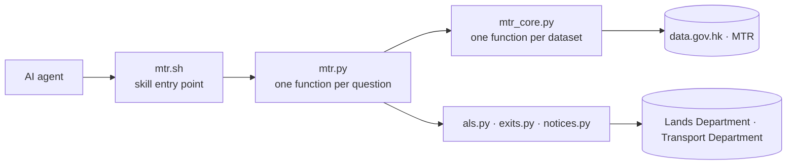

# 🚇 hk-transport · 港交寶


[](https://github.com/gnokit/hk-transport/actions/workflows/tests.yml)
<!-- Private repo: GitHub serves Actions badges anonymously only for public
     repos, so the live badge 404s. When this goes public, replace the line
     above with:
      -->

**An AI agent skill for Hong Kong public transport — MTR first.**

A skill an AI agent loads when someone asks how to get around Hong Kong. The agent talks to the person; the skill supplies the facts through 14 commands. Every command returns one JSON envelope with its own source: the dataset, the endpoint actually called, and the time the data describes.

English · [繁體中文](README.zh.md)

---

## What this is

`hk-transport` is a skill, not an app and not a chatbot. It ships as a small command set (`mtr.sh`) that an AI agent runs to answer one kind of citizen question at a time — which stations a line has, where to change trains, what a fare costs, when the next train arrives.

The split is deliberate:

- **The agent speaks; the skill states.** Commands return facts. They do not chat, do not choose a "best route" for anyone, and never fill a gap with a plausible number.
- **Absence is an answer.** When the published data cannot support a reply, `data` is `null` and `note` says why.
- **Every figure is traceable.** A missing field stays empty and is explained — never replaced from another ticket type, another file, or a guess.

It is the transport-focused sibling of [`hkdata`](https://github.com/gnokit/hkdata): `hkdata` covers all of data.gov.hk, this project covers public transport only, one command per question a citizen actually asks.

### Roadmap

Phase 1 ships one entry script, `mtr.sh`. Every later phase adds a sibling script built the same way — `bus.sh`, `minibus.sh`, `tram.sh` — so an agent learns the pattern once and the modes stay independent.

| Phase | Modes | Entry script | Status |
|---|---|---|---|
| 1 | MTR heavy rail, Airport Express, Disneyland Resort Line, Light Rail, feeder buses | `mtr.sh` | ✅ 14 commands |
| 2 | Franchised buses | `bus.sh` | not started |
| 3 | Green minibus, red minibus | `minibus.sh` | not started |
| 4 | Tram, ferry | `tram.sh`, `ferry.sh` | not started |
| 5 | Taxi, cross-boundary and high-speed rail | `taxi.sh`, `rail.sh` | not started |

Every phase ships the same five things:

1. **A scope section in [docs/TASKS.md](docs/TASKS.md)** — written before any code.
2. **A core module** — one function per dataset, whole tables, no filtering.
3. **An answer module** — one function per citizen question, no URL, no cache.
4. **An entry script `<mode>.sh`** — same manual: no arguments lists commands, `help <command>` explains one, stdout is JSON.
5. **Tests** — offline by default, plus `live`-marked checks that never gate CI.

What phase 1 built stays shared rather than copied: the result envelope (`_result`), the 30-day fetch cache (`_http`), cell reading (`_values`), address lookup (`als`), and the two Transport Department feeds (`notices`).

Two honest caveats: nothing in phases 2–5 exists yet, and the order above is a plan, not a commitment — each phase's real scope gets written into `docs/TASKS.md` first. KMB and ferry code already lives in [`hkdata`](https://github.com/gnokit/hkdata); those phases decide whether to move it or wrap it.

## Quick start

```bash
git clone https://github.com/gnokit/hk-transport.git && cd hk-transport
bash mtr.sh                                          # the manual: one line per command
bash mtr.sh help mtr_next_train                      # that command's arguments
bash mtr.sh mtr_next_train 港島線 金鐘                # ask a question
```

`mtr.sh` prints one JSON envelope. Trimmed, from a real call:

```json
{
  "dataset_id": ["mtr-data-routes-fares-barrier-free-facilities", "mtr-data2-nexttrain-data"],
  "endpoint": ["…/mtr_lines_and_stations.csv", "…/getSchedule.php?line=ISL&sta=ADM&lang=tc"],
  "data_at": "2026-10-29T12:58:16+08:00",
  "update_frequency": "10s",
  "data": {
    "line_zh": "港島線",
    "station": { "id": "2", "code": "ADM", "name_zh": "金鐘", "name_en": "Admiralty" },
    "directions": [{ "direction": "UP", "trains": [{ "dest": { "name_zh": "柴灣" }, "platform": "3", "ttnt": "2" }] }]
  },
  "note": "這次回應沒有特別安排"
}
```

`data_at` is the time the data describes, in Hong Kong time — kept separate from `retrieved_at`, when it was fetched. A monthly file has no timestamp, so `data_at` is `null` and `update_frequency` carries the truth instead.

## What you can ask

Each command answers one kind of question. These are phase 1.

**Heavy rail**

| Command | Answers |
|---|---|
| `mtr_lines` | Which stations a line has, or which lines serve a station |
| `mtr_journey` | Which line to ride, where to transfer, stations in between |
| `mtr_fare` | Octopus and single-journey fare, every ticket type in the file |
| `mtr_airport_express_fare` | Airport Express fare — adult and child only |
| `mtr_next_train` | Next trains, terminus, platform, and any service alert |
| `mtr_ride_estimate` | In-vehicle minutes, estimated from live arrivals |
| `mtr_barrier_free` | Which barrier-free facilities a station has, and at which exit |
| `mtr_exits` | Exit coordinates for one station |

**Light Rail and feeders**

| Command | Answers |
|---|---|
| `light_rail` | Stop order on a route, or the fare between two stops |
| `light_rail_next` | Next departures from one stop, special departures marked |
| `mtr_bus` | Feeder-bus stops, per-route fare, and next arrivals |

**Location and traffic**

| Command | Answers |
|---|---|
| `address_lookup` | Match a place name or address, with coordinates |
| `special_traffic_news` | Current territory-wide traffic incidents |
| `special_traffic_arrangements` | Traffic arrangements published in advance |

Station input accepts a Chinese name, an English name, a station id (`2`), or a code (`ADM`). Names must be spelled as published. If a name matches more than one station, the commands say so rather than picking one.

## Design rules

These are the reason the project exists, not decoration.

- ✅ **Never invent a figure.** No published trip time exists, so `mtr_ride_estimate` derives minutes from live arrivals — and returns `null` for the whole trip when any link's trains don't agree.
- ✅ **Every answer is auditable.** `dataset_id`, the endpoint called, `data_at`, `update_frequency`, and per-source detail in `sources`.
- ✅ **Absence is stated, not smoothed over.** No alert becomes 「這次回應沒有特別安排」 — never "all services normal".
- ✅ **Caching is explicit.** Monthly CSVs live 30 days in `.cache/`; live APIs and the traffic feeds are never cached; the exit snapshot is reused for about a year.
- ✅ **Straight-line is not walking time.** A distance computed from coordinates is labelled as what it is.
- 🚫 **No politeness, no itinerary.** A command returns facts; the agent writes the sentence.

## Architecture



Two layers, plus small shared modules (`_result` envelope, `_http` fetch, `_values` cell reading). `mtr.py` holds no URL and no cache; it only composes core functions. A new question reuses existing core functions — only a new data source adds one.

Scope is specified in [docs/TASKS.md](docs/TASKS.md); agent-facing instructions are in [SKILL.md](SKILL.md).

## Scope

| Covered in phase 1 | Not yet |
|---|---|
| MTR heavy rail, Airport Express, Disneyland Resort Line | Franchised bus, green minibus, red minibus, tram, ferry, taxi |
| Light Rail and MTR feeder buses | Cross-boundary rail, high-speed rail, intercity services |
| Address lookup, station exits, barrier-free facilities | Which exit serves a particular building |
| Territory-wide traffic news and advance arrangements | Crowding levels, first and last trains |

## Data sources & licence

Data comes from [DATA.GOV.HK](https://data.gov.hk): four MTR datasets, plus the Lands Department address lookup, location search and coordinate transform, and the Transport Department's traffic news and advance arrangements. Use is subject to the [data.gov.hk terms](https://data.gov.hk/tc/terms-and-conditions).

This project's own code is [MIT licensed](LICENSE). That licence covers the code only: the bundled exit snapshot in `src/hk_transport/data/mtr_exits.json` is derived from Lands Department data and stays subject to the data.gov.hk terms — see [NOTICE](NOTICE).

## Development

```bash
uv run pytest                          # 66 offline tests
uv run pytest -m live -o addopts=      # 8 live checks against the real endpoints
```

The offline suite is what CI runs. Live tests call data.gov.hk, so they are opt-in and never gate a build.

## Status

Phase 1 is complete. The skill answers MTR questions — heavy rail, Airport Express, Disneyland Resort Line, Light Rail, feeder buses, addresses, exits, and the two Transport Department feeds — through 14 commands. Later transport modes are listed in the roadmap above and in [docs/TASKS.md](docs/TASKS.md).
