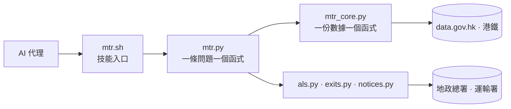

# 🚇 港交寶 · hk-transport


[](https://github.com/gnokit/hk-transport/actions/workflows/tests.yml)
<!-- Private repo: GitHub serves Actions badges anonymously only for public
     repos, so the live badge 404s. When this goes public, replace the line
     above with:
      -->

**一個香港公共交通的 AI agent skill——港鐵先行。**

這是一個 AI 代理會載入的技能，用在市民問「點樣去」的時候。代理同市民對話；技能透過 14 個指令提供事實。每個指令回傳一段 JSON 信封，帶自己的出處：資料集、實際查過的端點，以及數據描述的時間。

[English](README.md) · 繁體中文

---

## 這是什麼

`hk-transport` 是一個技能，不是應用程式，也不是聊天機械人。它以一小組指令（`mtr.sh`）發布，代理每次跑一個指令，答一整類市民問題——一條線有哪些站、在哪裡轉車、車費幾多、下一班幾時到。

這個分工是刻意的：

- **代理講說話，技能講事實。** 指令交還事實，唔會對話、唔替市民揀「最好的行程」、唔會用一個看似合理的數字填補空白。
- **沒有就是答案。** 公布的數據支持不到時，`data` 是 `null`，`note` 講明原因。
- **每個數字查得到。** 缺的欄位留空並說明——唔會用另一種票、另一份檔或猜測補上。

這是 [`hkdata`](https://github.com/gnokit/hkdata) 的交通專門版：`hkdata` 覆蓋 data.gov.hk 全部開放數據，這個專案只做公共交通，一個指令對準一條市民真正會問的問題。

### 路線圖

第一階段出一個入口腳本 `mtr.sh`。之後每個階段在旁邊加一個用同一套做法寫的腳本——`bus.sh`、`minibus.sh`、`tram.sh`——代理學一次就識用，各模式亦互不相干。

| 階段 | 交通模式 | 入口腳本 | 狀態 |
|---|---|---|---|
| 1 | 港鐵重鐵、機場快線、迪士尼線、輕鐵、接駁巴士 | `mtr.sh` | ✅ 14 個指令 |
| 2 | 專營巴士 | `bus.sh` | 未開始 |
| 3 | 綠色專線小巴、紅色小巴 | `minibus.sh` | 未開始 |
| 4 | 電車、渡輪 | `tram.sh`、`ferry.sh` | 未開始 |
| 5 | 的士、跨境鐵路同高速鐵路 | `taxi.sh`、`rail.sh` | 未開始 |

每個階段都要交同一組五樣東西：

1. **[docs/TASKS.md](docs/TASKS.md) 裡的範圍**——寫程式之前先寫。
2. **核心模組**——一份數據一個函式，交還整份表，不篩選。
3. **回答模組**——一條市民問題一個函式，沒有 URL，沒有快取。
4. **入口腳本 `<mode>.sh`**——同一套說明：冇參數列出指令，`help <command>` 講參數，stdout 係 JSON。
5. **測試**——預設離線，另加 `live` 標記的檢查，不用來卡 CI。

第一階段建好的東西共用，不複製：結果信封（`_result`）、30 日下載快取（`_http`）、讀格（`_values`）、地址查詢（`als`），以及運輸署兩份交通消息（`notices`）。

兩點照直講：第二至第五階段未有程式，上面的次序是計劃不是承諾——每階段的實際範圍會先寫入 `docs/TASKS.md`。九巴同渡輪的程式目前留在 [`hkdata`](https://github.com/gnokit/hkdata)，到時再決定搬過來還是包一層。

## 快速開始

```bash
git clone https://github.com/gnokit/hk-transport.git && cd hk-transport
bash mtr.sh                                          # 功能表：每個指令一行
bash mtr.sh help mtr_next_train                      # 該指令的參數
bash mtr.sh mtr_next_train 港島線 金鐘                # 問一條問題
```

`mtr.sh` 印出一段 JSON。以下是真實回應的節錄：

```json
{
  "dataset_id": ["mtr-data-routes-fares-barrier-free-facilities", "mtr-data2-nexttrain-data"],
  "endpoint": ["…/mtr_lines_and_stations.csv", "…/getSchedule.php?line=ISL&sta=ADM&lang=tc"],
  "data_at": "2026-10-29T12:58:16+08:00",
  "update_frequency": "10s",
  "data": {
    "line_zh": "港島線",
    "station": { "id": "2", "code": "ADM", "name_zh": "金鐘", "name_en": "Admiralty" },
    "directions": [{ "direction": "UP", "trains": [{ "dest": { "name_zh": "柴灣" }, "platform": "3", "ttnt": "2" }] }]
  },
  "note": "這次回應沒有特別安排"
}
```

`data_at` 是數據描述的時間（香港時間），同 `retrieved_at`（擷取時間）分開。每月檔案沒有時間欄，`data_at` 就是 `null`，由 `update_frequency` 交代更新頻率。

## 可以問什麼

每個指令答一整類問題。以下屬於第一階段。

**重鐵**

| 指令 | 回答 |
|---|---|
| `mtr_lines` | 一條線有哪些站；一個站屬於哪幾條線 |
| `mtr_journey` | 乘哪條線、在哪裡轉車、中間停哪些站 |
| `mtr_fare` | 八達通同單程票車費，檔案有的每一種票 |
| `mtr_airport_express_fare` | 機場快線車費——只有成人同小童 |
| `mtr_next_train` | 下一班、終點站、月台，以及特別車務安排 |
| `mtr_ride_estimate` | 車上大約幾耐，用實時到站時間估算 |
| `mtr_barrier_free` | 一個站有哪些無障礙設施、在哪個出口 |
| `mtr_exits` | 一個車站的出口座標 |

**輕鐵與接駁**

| 指令 | 回答 |
|---|---|
| `light_rail` | 一條路線的停站順序，或兩站之間車費 |
| `light_rail_next` | 一個站即將開出的班次，特別班會標明 |
| `mtr_bus` | 接駁巴士停站、以路線計的車費、各站下一班 |

**位置與交通消息**

| 指令 | 回答 |
|---|---|
| `address_lookup` | 地名或地址的匹配結果同座標 |
| `special_traffic_news` | 運輸署現時的全港特別交通消息 |
| `special_traffic_arrangements` | 預先公布的特別交通及運輸安排 |

站名接受中文、英文、車站編號（`2`）或車站代碼（`ADM`）。名稱要同公布的一致。一個名稱對應多於一個車站時，指令會列出來，不會替你揀一個。

## 設計原則

這幾條是這個專案存在的理由，不是裝飾。

- ✅ **唔編造數字。** 公開數據沒有行車時間，`mtr_ride_estimate` 就用實時到站時間估算；任何一段的班次對不齊，全程 `null`。
- ✅ **每個答案查得到出處。** `dataset_id`、實際查過的端點、`data_at`、`update_frequency`，以及逐個來源的 `sources`。
- ✅ **沒有就講沒有。** 沒有警報時寫「這次回應沒有特別安排」，唔寫成「全線正常」。
- ✅ **快取政策明確。** 每月 CSV 在 `.cache/` 留 30 日；實時 API 同交通消息不快取；出入口快照約一年內重用。
- ✅ **直線不是步行時間。** 由座標算出的距離會標明是直線。
- 🚫 **唔寒暄、唔排行程。** 指令交事實，句子由代理寫。

## 架構



兩層，加幾個共用小模組（`_result` 信封、`_http` 下載、`_values` 讀格）。`mtr.py` 沒有 URL，也沒有快取，只組合核心函式。新的問題組合現有核心函式；只有新的數據源才加一個核心函式。

範圍寫在 [docs/TASKS.md](docs/TASKS.md)；給代理的指示在 [SKILL.md](SKILL.md)。

## 範圍

| 第一階段覆蓋 | 尚未做 |
|---|---|
| 港鐵重鐵、機場快線、迪士尼線 | 專營巴士、綠色專線小巴、紅色小巴、電車、渡輪、的士 |
| 輕鐵同港鐵接駁巴士 | 跨境鐵路、高速鐵路、城際客運 |
| 地址查詢、車站出入口、無障礙設施 | 去某座大廈行哪個出口 |
| 全港交通消息同預先公布安排 | 車廂或月台擠迫程度、頭班車與尾班車 |

## 資料來源與授權

數據來自 [DATA.GOV.HK](https://data.gov.hk)：港鐵 4 個數據集，加地政總署的地址查詢、地理位置搜尋同坐標轉換，以及運輸署的特別交通消息同特別交通及運輸安排。使用時受其[條款](https://data.gov.hk/tc/terms-and-conditions)約束。

這個專案的程式以 [MIT 授權](LICENSE) 發布。這個授權只涵蓋程式：`src/hk_transport/data/mtr_exits.json` 是由地政總署數據衍生的快照，仍然受 data.gov.hk 條款約束——見 [NOTICE](NOTICE)。

## 開發

```bash
uv run pytest                          # 66 個離線測試
uv run pytest -m live -o addopts=      # 8 個實時檢查，打真端點
```

CI 只跑離線測試。實時測試會呼叫 data.gov.hk，所以是自選的，不會用來卡住建置。

## 狀態

第一階段完成。技能用 14 個指令答港鐵問題——重鐵、機場快線、迪士尼線、輕鐵、接駁巴士、地址、出入口，以及運輸署兩份交通消息。後面的交通模式見上面的路線圖同 [docs/TASKS.md](docs/TASKS.md)。
